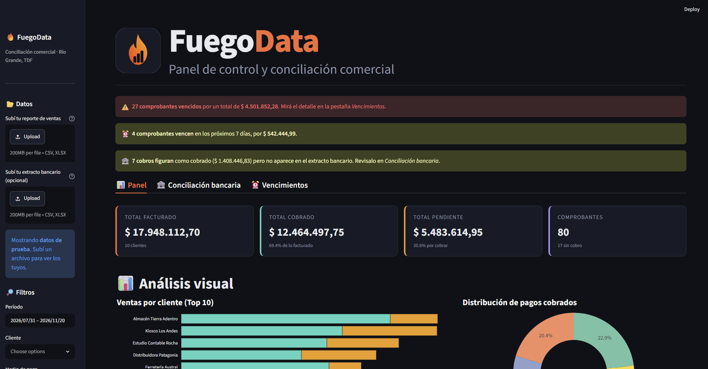
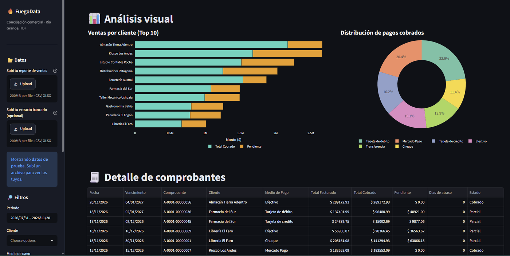
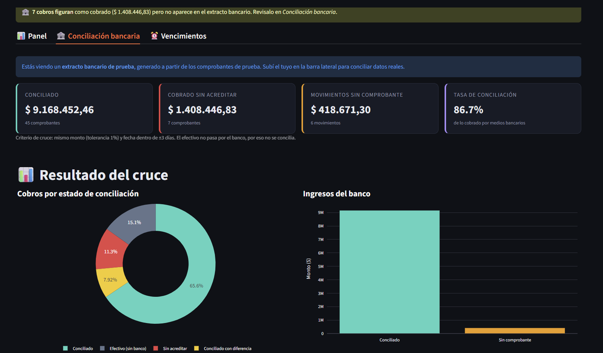
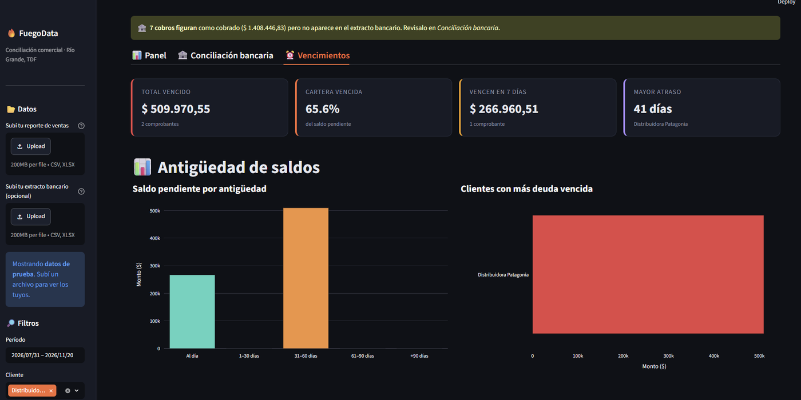

# 🔥 FuegoData: panel de control y conciliación comercial

Aplicación web para **comercios y estudios contables de Río Grande, Tierra del Fuego**. Procesa reportes de ventas o comprobantes (CSV/Excel) y extractos bancarios, y muestra al instante cuánto se facturó, cuánto se cobró, qué falta cobrar y qué cobros no aparecen en el banco.

> 🔒 **Código privado.** Este repositorio muestra la aplicación funcionando con datos de prueba. El código está disponible para revisión en entrevistas técnicas.

---

## ✨ Funcionalidades

- **Alertas automáticas:** comprobantes vencidos, comprobantes que vencen en los próximos 7 días y cobros registrados que no figuran en el extracto bancario.
- **Panel de KPIs:** total facturado, total cobrado, pendiente y cantidad de comprobantes, con filtros por período, cliente, medio de pago y estado de cobro.
- **Análisis visual:** ventas por cliente (cobrado vs. pendiente) y distribución de los cobros por medio de pago.
- **Conciliación bancaria:** cruce de cobros contra el extracto por monto (con tolerancia porcentual) y fecha (con tolerancia en días). Clasifica cada movimiento en conciliado, conciliado con diferencia, cobrado sin acreditar o movimiento sin comprobante, y calcula la tasa de conciliación. El efectivo se separa porque no pasa por el banco.
- **Vencimientos:** total vencido, cartera vencida, antigüedad de saldos por tramos y clientes con más deuda vencida.
- **Detalle de comprobantes** con exportación a Excel y CSV.
- **Datos de prueba** incluidos, para probar la app sin información real.

## 🛠️ Tecnologías

Python · Streamlit · pandas · NumPy · Plotly · openpyxl

---

## 📸 Capturas

| Alertas y KPIs | Análisis visual y detalle |
|---|---|
|  |  |
| **Conciliación bancaria** | **Vencimientos y antigüedad de saldos** |
|  |  |

---

## 👩‍💻 Autora

**Miriam Alicia Velazque** (MAVA): diseño y desarrollo.
[LinkedIn](https://www.linkedin.com/in/miriam-alicia-velazque) · [GitHub](https://github.com/miriamvelazque)
